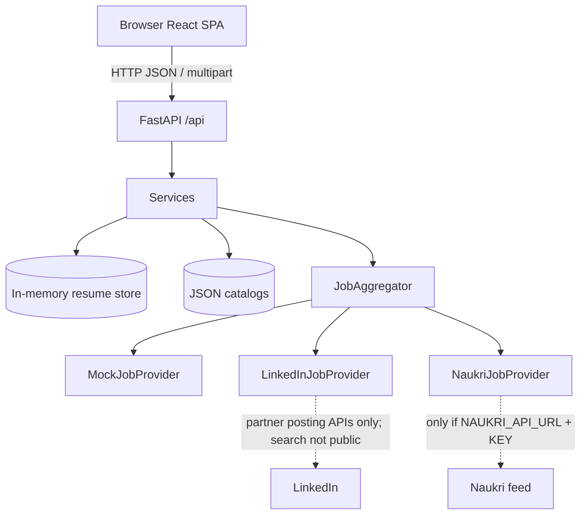

# CareerCratly.AI

Academic full-stack prototype for **resume intelligence**, **role alignment**, **job discovery** (demo + optional authorized providers), **learning recommendations**, and **interview practice**.

> Transparent scoring. No accounts. No scraping of LinkedIn or Naukri. Demo jobs are labeled and are not live vacancies.

---

## Overview

Students and early-career professionals often cannot see *why* a resume matches a target role or what to improve next. CareerCratly.AI:

1. Uploads a PDF/DOCX resume  
2. Extracts skills with a taxonomy matcher (spaCy PhraseMatcher)  
3. Computes an explainable **Resume Match Score** against a target role  
4. Returns deep section / keyword / bullet / project / roadmap analysis  
5. Searches jobs through a provider aggregator (mock demo by default)  
6. Recommends courses and project resources for missing skills  
7. Offers text-based interview Q&A evaluation (camera optional; no biometric scoring)

---

## Key features

| Area | What is implemented |
|------|---------------------|
| Resume upload | PDF/DOCX (≤ 5 MB), text extraction |
| Skill extraction | Taxonomy + aliases via spaCy PhraseMatcher |
| Resume Match Score | Weighted, deterministic, explicitly **not** a proprietary ATS |
| Deep intelligence | Sections, keywords, bullets, projects, improvement roadmap |
| Job portal | Filters, source status, demo listings, resume↔job match |
| Providers | LinkedIn / Naukri adapters report `not_configured` without credentials; mock always available |
| Learning | Course catalog + project/research links |
| Interview prep | Role/difficulty questions + keyword/structure scoring |
| Frontend | Responsive React SPA, adaptive 3D hero, tabbed analysis dashboard |

---

## Screenshots

_Add screenshots after capturing the running UI:_

| Screen | Placeholder |
|--------|-------------|
| Landing | `docs/screenshots/landing.png` |
| Resume analysis | `docs/screenshots/resume-analysis.png` |
| Job portal | `docs/screenshots/job-portal.png` |

---

## Architecture



**Rule:** provider secrets stay on the backend. The browser only calls FastAPI (`VITE_API_BASE_URL`).

---

## Technology stack

### Frontend (`frontend/`)
- React 19, TypeScript, Vite 8  
- React Router 7, Zustand, Axios  
- Tailwind CSS 4, Motion, Lenis  
- Three.js + React Three Fiber (hero)

### Backend (`backend/`)
- Python 3.11+, FastAPI, Uvicorn  
- pdfplumber, python-docx  
- spaCy, scikit-learn  
- httpx (optional Naukri feed)  
- pytest  

---

## Project structure

```
.
├── README.md                 # This file
├── .gitignore
├── docs/
│   └── PROJECT_REPORT.md     # Detailed academic report
├── scripts/
│   └── generate_report_pdf.py
├── frontend/
│   ├── .env.example
│   ├── package.json
│   ├── index.html
│   └── src/
│       ├── App.tsx
│       ├── pages/            # Landing, Resume, Jobs, Interview, About
│       ├── components/       # 3D, resume dashboard, layout, UI
│       ├── services/         # resume.ts, jobs.ts
│       ├── lib/api.ts
│       ├── store/
│       └── types/
└── backend/
    ├── .env.example
    ├── requirements.txt
    ├── app/
    │   ├── main.py
    │   ├── api/              # Active HTTP routes
    │   ├── core/
    │   ├── schemas/
    │   ├── models/           # Lightweight domain enums/models
    │   ├── services/         # Parse, ATS, intelligence, matching
    │   ├── providers/        # Jobs / courses / research adapters
    │   └── data/             # skills, roles, jobs, courses, …
    ├── tests/
    ├── legacy/               # Unwired auth/DB experiment (not active)
    └── uploads/              # Local uploads (gitignored contents)
```

---

## Prerequisites

- **Node.js** 20+ and npm  
- **Python** 3.11 or 3.12 (spaCy 3.8.x; avoid 3.14 if wheels are unavailable)  
- Windows PowerShell, macOS, or Linux terminal  
- Optional: Docker (backend `docker compose`)

---

## Installation

### 1. Backend

```powershell
cd backend
python -m venv .venv
.\.venv\Scripts\Activate.ps1
pip install -r requirements.txt
copy .env.example .env
```

> spaCy may download a small model on first skill-extractor use depending on your environment. If extraction fails on first run, follow the spaCy error message to install the required package.

### 2. Frontend

```powershell
cd frontend
npm install
copy .env.example .env
```

---

## Environment variables

### Frontend — `frontend/.env.example`

| Variable | Description |
|----------|-------------|
| `VITE_API_BASE_URL` | Backend origin, e.g. `http://localhost:8000` |

Only non-secret values belong in `VITE_*` (they are exposed to the browser).

### Backend — `backend/.env.example`

| Variable | Description |
|----------|-------------|
| `APP_NAME` | OpenAPI title (`CareerCratly.AI`) |
| `ENVIRONMENT` | `development` enables permissive CORS |
| `API_PREFIX` | Default `/api` |
| `UPLOAD_DIR` / `MAX_RESUME_SIZE_BYTES` | Upload storage limits |
| `JOB_PROVIDER` / `COURSE_PROVIDER` / `PROJECT_PROVIDER` | Provider selection |
| `LINKEDIN_*` | Partner credentials (job **search** still unavailable publicly) |
| `NAUKRI_API_KEY` / `NAUKRI_API_URL` | Optional official feed only |

Copy examples to `.env` locally. **Never commit `.env` files.**

---

## Run (development)

Use **two terminals**.

### Terminal 1 — API

```powershell
cd backend
.\.venv\Scripts\Activate.ps1
uvicorn app.main:app --reload --host 127.0.0.1 --port 8000
```

- API: http://127.0.0.1:8000  
- Swagger: http://127.0.0.1:8000/docs  

### Terminal 2 — UI

```powershell
cd frontend
npm run dev
```

- App: http://localhost:5173/ (Vite may pick 5174 if busy)

### Docker (API only)

```powershell
cd backend
docker compose up --build
```

---

## API endpoints (summary)

| Method | Path | Purpose |
|--------|------|---------|
| GET | `/api/health` | Liveness |
| POST | `/api/resume/upload` | Upload PDF/DOCX |
| POST | `/api/resume/analyze` | Match score + intelligence |
| GET | `/api/jobs` | List jobs |
| GET | `/api/jobs/search` | Filtered search |
| GET | `/api/jobs/sources` | Provider status |
| POST | `/api/jobs/match` | Rank jobs vs resume |
| GET | `/api/courses/recommend` | Courses for skills/gaps |
| GET | `/api/projects/resources` | Project/research links |
| GET | `/api/interview/questions` | Question bank |
| POST | `/api/interview/evaluate` | Score a text answer |

Interactive docs: `/docs`.

---

## Testing & quality

```powershell
# Backend
cd backend
pytest -q

# Frontend
cd frontend
npm run lint
npm run build
```

---

## Security considerations

- No user accounts in the active prototype path  
- Uploaded files stay under `backend/uploads/` and are not publicly served as static files  
- Provider API keys must remain server-side  
- Job adapters do **not** scrape LinkedIn/Naukri or bypass ToS  
- External job links use `noopener noreferrer`  
- Interview evaluation is text-based only (no emotion/face scoring)  

---

## Known limitations

- Resume store is **in-memory** (lost on API restart)  
- LinkedIn has no public general-purpose job-search API for this product  
- Naukri is live only with an approved feed URL + key  
- Demo jobs are static JSON  
- Scoring is explainable/heuristic, not a commercial ATS  
- `backend/legacy/` is historical and unwired  

---

## Documentation

- Detailed report: [`docs/PROJECT_REPORT.md`](docs/PROJECT_REPORT.md)  
- Optional PDF generator: `python scripts/generate_report_pdf.py` (requires `reportlab` in the backend venv)

---

## Contributing

This is an academic prototype. If you fork it:

1. Keep secrets out of git  
2. Prefer extending providers behind `JobProvider` rather than scraping  
3. Keep the Resume Match Score transparent and labeled  

---

## License

No license file is included in this repository yet. Add a `LICENSE` if you choose an open-source license before publishing.

---

## Publishing checklist (GitHub)

- [ ] Confirm no `.env`, `*.db`, `uploads/*`, or `node_modules` will be committed  
- [ ] Initialize git **only when you are ready** (`git init` is intentionally not run by this cleanup)  
- [ ] Create the GitHub repo, add `origin`, then push  
- [ ] Replace the old remote contents only with a deliberate force strategy **you** approve  
- [ ] Add screenshots under `docs/screenshots/` if desired  
- [ ] Choose and add a `LICENSE` if required by your course/org  
