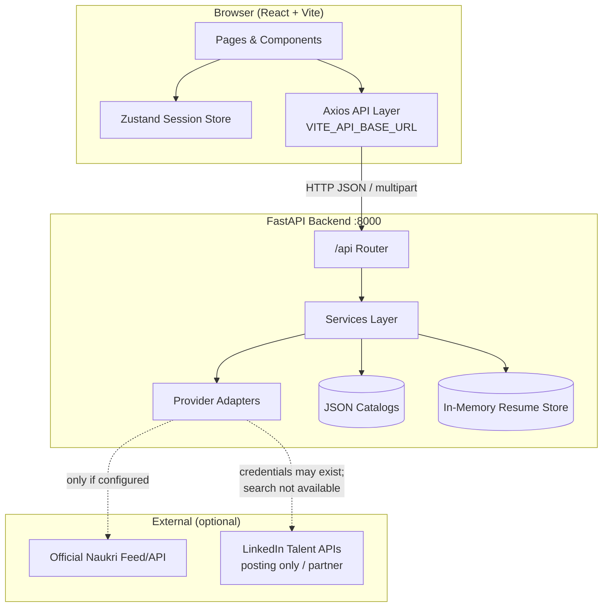
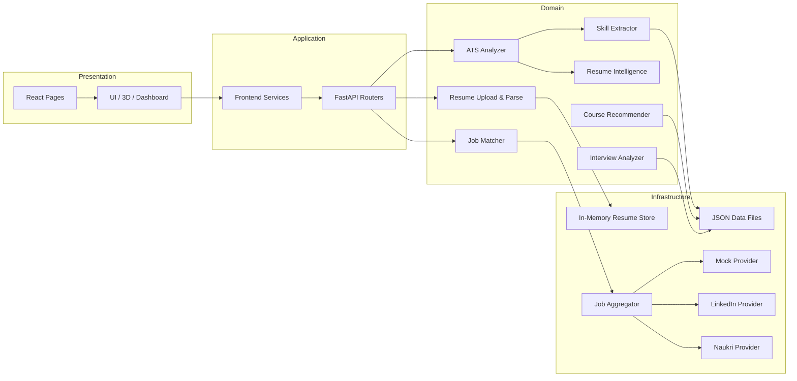
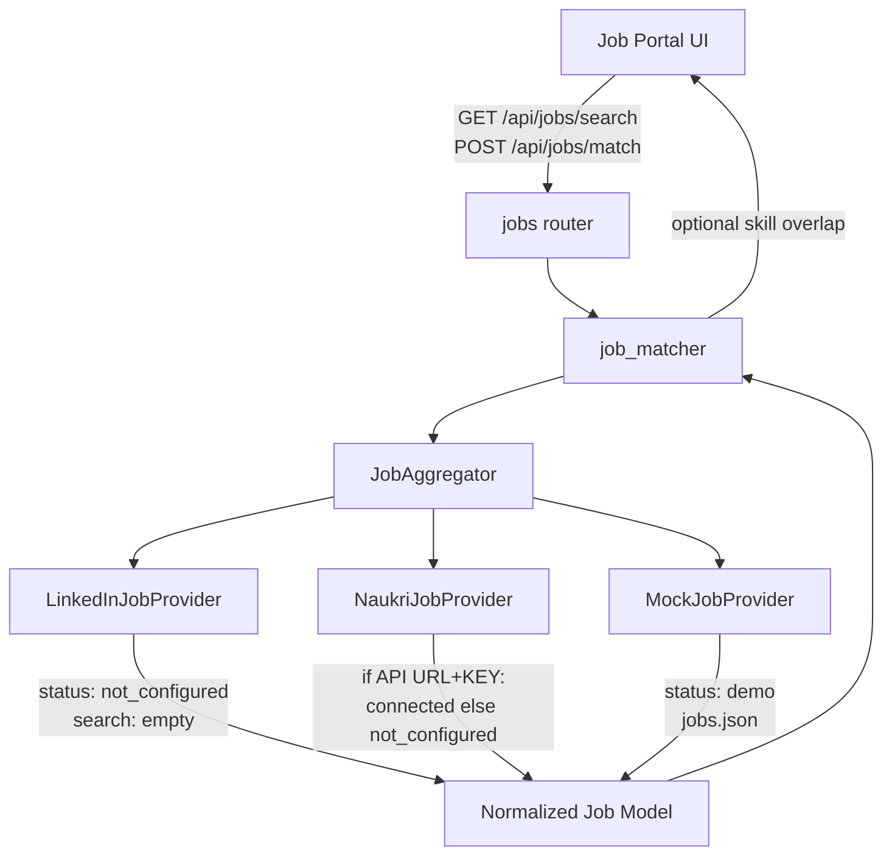
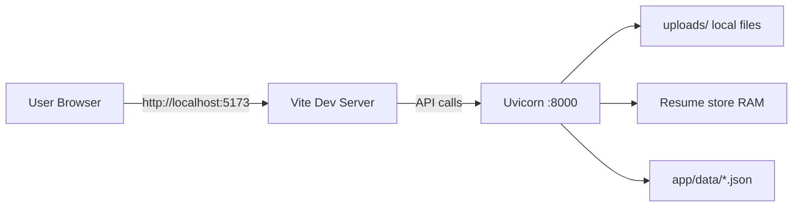
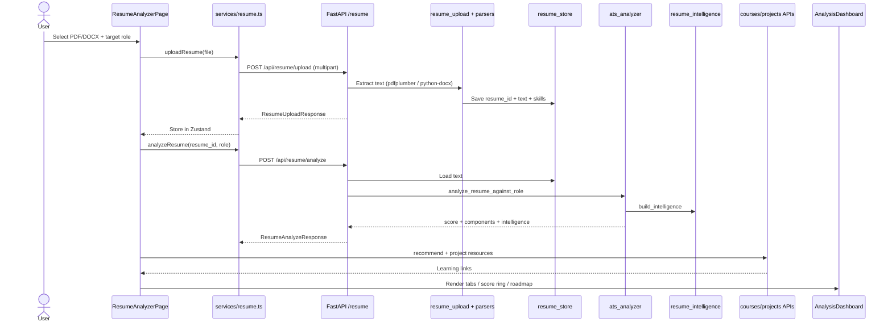
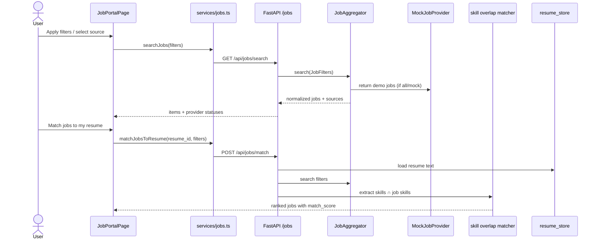
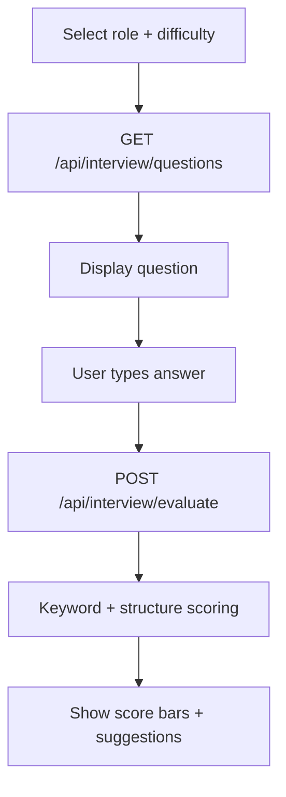
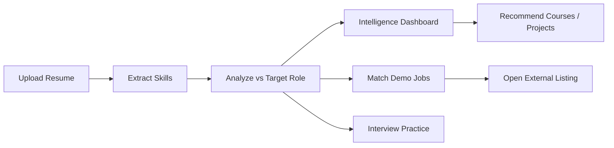

# Resume Analyzer + Job Portal  
## In-Depth Academic Project Report

**Project type:** Full-stack academic prototype  
**Domain:** Career intelligence — resume analysis, role matching, job discovery, learning recommendations, interview practice  
**Auth model:** No accounts / no login (session-scoped resume store)  
**Version:** Frontend Vite/React SPA + Backend FastAPI `0.2.0`  
**Document date:** September 2026  

---

## 1. Executive Summary

This project is an academic **Resume Analyzer + Job Portal** that turns a candidate’s resume into actionable career intelligence. Users upload a PDF or DOCX resume, select a target role, and receive:

1. An explainable **Resume Match Score** (not a proprietary ATS claim)  
2. Deep **resume intelligence** (sections, bullets, keywords, projects, roadmap)  
3. **Job listings** from a multi-provider architecture (demo listings by default; LinkedIn/Naukri adapters only when legitimately configured)  
4. **Course and project resource** recommendations for missing skills  
5. A lightweight **interview Q&A** practice module  

The system is intentionally transparent: scoring weights are documented, demo jobs are labeled, and external job providers report `not_configured` instead of fabricating live LinkedIn/Naukri results.

---

## 2. Problem Statement

Students and early-career professionals struggle to:

- Understand **why** a resume aligns (or fails to align) with a target role  
- Discover **specific, ethical** next steps (skills, projects, certifications)  
- Browse jobs without relying on scraping or fake “live” board data  
- Practice interview answers with structured, non-biometric feedback  

Commercial ATS tools are opaque. Scraping job boards violates terms of service. This prototype addresses both problems with **explainable matching** and a **provider interface** that only uses authorized APIs/feeds when available.

---

## 3. Objectives

| # | Objective | Status in prototype |
|---|-----------|---------------------|
| 1 | Parse PDF/DOCX resumes and extract skills | Implemented |
| 2 | Score resume vs target role with transparent components | Implemented |
| 3 | Deliver deep section/bullet/keyword/roadmap analysis | Implemented |
| 4 | Aggregate jobs via provider adapters + demo fallback | Implemented |
| 5 | Match jobs to an uploaded resume on the backend | Implemented |
| 6 | Recommend courses/projects from catalogs | Implemented |
| 7 | Interview text evaluation (no emotion/face scoring) | Implemented |
| 8 | Responsive, full-viewport frontend with adaptive 3D | Implemented |
| 9 | No scraping of LinkedIn/Naukri | Enforced |

---

## 4. Scope

### In scope
- Resume upload (PDF/DOCX, ≤ 5 MB)  
- In-memory resume session store  
- Role-based skill taxonomy matching  
- Job search/filter/match with demo data  
- Provider status transparency (Connected / Demo / Not configured)  
- Course & project link recommendations  
- Interview question bank + deterministic text scoring  
- Responsive React UI with Three.js hero  

### Out of scope
- User accounts, JWT auth (legacy files may exist but are not wired)  
- Live LinkedIn job search (no public API)  
- Scraping or browser automation of career sites  
- LLM-based scoring as the primary engine  
- Facial, personality, or psychological analysis  
- Production multi-tenant persistence  

---

## 5. System Overview



**Critical architecture rule:** Secrets stay on the backend. The browser never holds LinkedIn/Naukri keys.

```
Browser → React → FastAPI → Providers
NOT: Browser → LinkedIn secret → LinkedIn
```

---

## 6. Technology Stack

### 6.1 Frontend

| Technology | Role |
|------------|------|
| React 19.2 | UI |
| TypeScript | Type safety |
| Vite 8 | Bundler / dev server |
| React Router 7 | Client routing |
| Tailwind CSS 4 | Styling |
| Axios | HTTP client |
| Zustand | Client session persistence |
| Three.js + R3F + Drei | 3D hero |
| Motion / Lenis / GSAP | Animation & smooth scroll |
| Sonner | Toasts |
| oxlint | Lint |

### 6.2 Backend

| Technology | Role |
|------------|------|
| Python 3.11+ | Runtime |
| FastAPI 0.115 | HTTP API |
| Uvicorn | ASGI server |
| Pydantic / pydantic-settings | Validation & config |
| pdfplumber | PDF text extraction |
| python-docx | DOCX extraction |
| spaCy PhraseMatcher | Skill extraction |
| scikit-learn (TF-IDF) | Keyword relevance |
| httpx | Optional Naukri HTTP calls |
| pytest | Automated tests |

### 6.3 Data (static catalogs)

Located under `backend/app/data/`:

- `skills.json` — skill taxonomy / aliases  
- `roles.json` — target roles with required/preferred/optional skills  
- `jobs.json` — demo job listings  
- `courses.json` — course recommendations  
- `projects.json` — project/research resource links  
- `interview.json` — interview question bank  

---

## 7. Repository Structure

```
No-Code/
├── backend/
│   ├── app/
│   │   ├── main.py                 # FastAPI app factory
│   │   ├── api/                    # HTTP routes
│   │   │   ├── resume.py
│   │   │   ├── jobs.py
│   │   │   ├── courses.py
│   │   │   ├── projects.py
│   │   │   ├── interview.py
│   │   │   └── health.py
│   │   ├── core/                   # config, CORS, logging, errors
│   │   ├── schemas/                # Pydantic I/O models
│   │   ├── services/               # business logic
│   │   │   ├── resume_upload.py
│   │   │   ├── skill_extractor.py
│   │   │   ├── ats_analyzer.py
│   │   │   ├── resume_intelligence.py
│   │   │   ├── job_matcher.py
│   │   │   └── ...
│   │   ├── providers/
│   │   │   ├── jobs/               # aggregator, linkedin, naukri, mock
│   │   │   ├── courses/
│   │   │   └── research/
│   │   └── data/                   # JSON catalogs
│   ├── tests/
│   ├── requirements.txt
│   ├── .env.example
│   └── README.md
└── frontend/
    ├── src/
    │   ├── pages/                  # Landing, Resume, Jobs, Interview, About
    │   ├── components/
    │   │   ├── 3d/
    │   │   ├── resume/             # AnalysisDashboard, ScoreRing, Upload
    │   │   └── layout/
    │   ├── services/               # resume.ts, jobs.ts
    │   ├── lib/api.ts              # Axios client
    │   ├── store/session.ts
    │   └── types/
    ├── .env.example
    └── package.json
```

---

## 8. Functional Modules

### 8.1 Landing / Experience
- Full-viewport hero with adaptive 3D (`HeroCanvas`)  
- Particle count, DPR, and camera motion scale by mobile/tablet/desktop  
- Respects `prefers-reduced-motion`  

### 8.2 Resume Analyzer
- Upload PDF/DOCX  
- Select or type target role  
- Display tabbed **Analysis Dashboard**: Summary, Sections, Skills, Keywords, Experience, Projects, Alignment, Learning, Roadmap  

### 8.3 Job Portal
- Filters: role/field, location, work mode, employment type, experience  
- Job sources: All / LinkedIn / Naukri / Demo  
- Provider status cards  
- Match jobs to uploaded resume  
- External “View Job ↗” links (`target="_blank"`, `rel="noopener noreferrer"`)  
- Demo listings clearly labeled  

### 8.4 Interview Prep
- Role + difficulty question loading  
- Optional camera preview (no biometric scoring)  
- Text answer evaluation: technical relevance, keywords, structure  

### 8.5 About
- Product narrative and flow steps  

---

## 9. Backend API Contract

Base URL: `http://localhost:8000`  
Prefix: `/api`  
Interactive docs: `/docs`

| Method | Endpoint | Purpose |
|--------|----------|---------|
| GET | `/api/health` | Liveness |
| POST | `/api/resume/upload` | Upload PDF/DOCX → `resume_id`, text, skills |
| POST | `/api/resume/analyze` | Resume Match Score + intelligence |
| GET | `/api/jobs` | List jobs |
| GET | `/api/jobs/search` | Filtered search (`role`, `location`, `work_mode`, `employment_type`, `experience_level`, `source`, `skills`) |
| GET | `/api/jobs/sources` | Provider status list |
| POST | `/api/jobs/match` | Rank jobs vs resume |
| GET | `/api/courses/recommend` | Courses for missing skills |
| GET | `/api/projects/resources` | Project/research links by topic |
| GET | `/api/interview/questions` | Question bank |
| POST | `/api/interview/evaluate` | Score a text answer |

---

## 10. Architecture Diagrams

### 10.1 Layered architecture



### 10.2 Job provider aggregation



**Normalized job fields:**  
`id`, `source`, `title`, `company`, `location`, `work_mode`, `employment_type`, `description`, `skills`, `posted_date`, `external_url`, `source_logo`, `is_demo`, and when matched: `match_score`, `matched_skills`, `missing_skills`.

### 10.3 Deployment / runtime topology



---

## 11. Data Flow Diagrams

### 11.1 Resume upload → analyze → dashboard



### 11.2 Job search and resume-aware matching



### 11.3 Interview evaluation flow



### 11.4 End-to-end career pipeline (product flow)



---

## 12. Resume Match Score (Explainable Formula)

The score is labeled **Resume Match Score** and explicitly **not** a company ATS ranking.

\[
\text{Score} = \mathrm{round}\big(
40\cdot R + 20\cdot P + 15\cdot K + 15\cdot E + 10\cdot S
\big)
\]

| Symbol | Component | Weight |
|--------|-----------|--------|
| \(R\) | Required skill coverage | 40% |
| \(P\) | Preferred skill coverage | 20% |
| \(K\) | Keyword relevance (TF-IDF cosine vs role skill corpus) | 15% |
| \(E\) | Experience / project language relevance | 15% |
| \(S\) | Section completeness | 10% |

Clamped to \([0, 100]\). Deterministic for the same resume text and role.

### Intelligence alignment components (dashboard)

- `overall_score`  
- `keyword_match`  
- `required_skill_coverage`  
- `preferred_skill_coverage`  
- `experience_relevance`  
- `project_relevance`  
- `section_completeness`  
- `achievement_strength`  
- `education_alignment`  
- `certification_alignment`  

Each includes an **explanation** string for transparency.

### Metric policy

The system **never invents** employers, percentages, user counts, or technologies. Recommendations use phrasing such as: *“Quantify the improvement if you have the actual measurement”* and *“Add this keyword only if you have genuine experience.”*

---

## 13. Deep Resume Intelligence

Module: `backend/app/services/resume_intelligence.py`

### Detected sections
Summary, Experience, Projects, Education, Skills, Certifications, Achievements (+ contact signals: email/phone/links).

### Per-section review
`status`, `score`, `strengths`, `issues`, `specific improvements`.

### Keyword gap
Detected / missing / weakly represented keywords + placement advice.

### Bullet analysis
Checks for action → technology → task → result structure; flags weak lines (`Worked on…`).

### Project analysis
Title, detected skills, missing information (metrics, deployment, dataset, architecture), recommendations.

### Improvement roadmap
Grouped into **High / Medium / Optional** with: Issue, Why it matters, What to do, Expected benefit.

---

## 14. Job Provider Design

### Interface (`JobProvider`)
- `status() → ProviderStatus`  
- `search(filters: JobFilters) → list[dict]`  

### Adapters

| Provider | Behavior |
|----------|----------|
| **MockJobProvider** | Always available; loads `jobs.json`; status `demo` |
| **LinkedInJobProvider** | Always `not_configured` for search — LinkedIn public APIs are Talent **Job Posting**, not general job search. No scraping. |
| **NaukriJobProvider** | `connected` only if `NAUKRI_API_URL` + `NAUKRI_API_KEY` are set and URL is safe HTTP(S); otherwise `not_configured` |

### Aggregator rules
- Skip non-mock providers that are not `connected`  
- For `source=all`, always include mock demo listings  
- Cap results with `MAX_JOBS`  

---

## 15. Frontend Architecture

### Routes

| Path | Page |
|------|------|
| `/` | Landing |
| `/resume-analyzer` | Resume Analyzer |
| `/job-portal` | Job Portal |
| `/interview-prep` | Interview Prep |
| `/about` | About |
| `/login`, `/register` | Redirect to `/` (no auth) |

### State
Zustand `session` store persists `resume` (text truncated), `analysis`, and `targetRole` in local storage (`lumen-session`).

### API layer
- `src/lib/api.ts` — Axios client + `parseApiError`  
- `src/services/resume.ts` — upload / analyze / courses / projects  
- `src/services/jobs.ts` — search / match / sources / getJob  

### Responsive strategy
- `min-height: 100svh`, full-width shells, content `max-w-[90rem]`  
- Desktop two-column hero; mobile stacked with compact 3D  
- Adaptive particle counts and DPR  

---

## 16. Environment Configuration

### Frontend (`frontend/.env.example`)
```env
VITE_API_BASE_URL=http://localhost:8000
```
Only non-secret browser-safe variables use the `VITE_` prefix.

### Backend (`backend/.env.example`)
| Variable | Purpose |
|----------|---------|
| `APP_NAME`, `ENVIRONMENT`, `DEBUG` | App metadata |
| `API_PREFIX` | Default `/api` |
| `CORS_ORIGINS` | Non-dev CORS allowlist |
| `UPLOAD_DIR`, `MAX_RESUME_SIZE_BYTES` | Upload limits |
| `JOB_PROVIDER`, `COURSE_PROVIDER`, `PROJECT_PROVIDER` | Provider selection |
| `LINKEDIN_*` | Partner credentials (search still unavailable) |
| `NAUKRI_API_KEY`, `NAUKRI_API_URL` | Optional official feed |

---

## 17. How to Run

### Terminal 1 — Backend
```powershell
cd "c:\JoyUNI\Courses and Internships\No-Code\backend"
.\.venv\Scripts\python.exe -m uvicorn app.main:app --host 127.0.0.1 --port 8000 --reload
```

### Terminal 2 — Frontend
```powershell
cd "c:\JoyUNI\Courses and Internships\No-Code\frontend"
npm run dev
```

- App: http://localhost:5173/  
- API docs: http://127.0.0.1:8000/docs  

### Tests / build
```powershell
# Backend
cd backend
pytest -q

# Frontend
cd frontend
npm run lint
npm run build
```

---

## 18. Testing Strategy

| Area | Coverage |
|------|----------|
| Resume parse | PDF/DOCX upload, invalid types/size |
| Skills / ATS | Deterministic scoring, intelligence payload |
| Jobs | Filter, match ranking, sources `not_configured` |
| Courses / interview | Recommend & evaluate endpoints |
| Frontend | Typecheck (`tsc -b`), lint, production build |
| Manual QA | Viewports 1920 / 1366 / 1024 / 768 / 390 |

---

## 19. Security & Ethics

- No password/auth surface in the active prototype path  
- Uploaded files stored locally; not publicly served as static assets  
- No scraping; no ToS bypass  
- External links use `noopener noreferrer`  
- Interview module explicitly avoids personality/emotion scoring  
- Provider UI never pretends demo data is live LinkedIn/Naukri  

---

## 20. Limitations

1. Resume store is **in-memory** — lost on API restart  
2. LinkedIn job **search** is not available via official public API  
3. Naukri is live only with an approved feed/API  
4. Demo jobs are static JSON  
5. Scoring is heuristic/deterministic, not commercial ATS  
6. Interview scoring is keyword/structure-based, not LLM judgment  
7. Leftover auth/DB experiment files may exist but are not part of the active no-auth path  

---

## 21. Future Enhancements

- Persist resumes in PostgreSQL for multi-session use  
- Plug licensed job feeds into `JobProvider`  
- Optional LLM extraction behind the existing extractor interface  
- Speech-to-text into interview evaluate  
- Auth only if a later product phase requires accounts  
- Deeper analytics visualizations and exportable PDF reports  

---

## 22. Conclusion

The **Resume Analyzer + Job Portal** demonstrates a complete, ethically constrained academic pipeline: parse → extract → explainably score → recommend learning → match demo (or authorized) jobs → rehearse interviews. Architecture separates presentation, API, domain services, and swappable providers; diagrams above document both control flow and data flow for evaluation and further development.

---

## Appendix A — Target Roles (catalog)

Backend Developer, Python Developer, Software Engineer, Full Stack Developer, Data Scientist, Data Analyst, AI Engineer, Machine Learning Engineer, Cloud Engineer, Business Analyst.

## Appendix B — Sample API payloads

**Upload response (truncated):**
```json
{
  "resume_id": "…",
  "filename": "resume.pdf",
  "file_type": "pdf",
  "extracted_skills": ["Python", "FastAPI"],
  "pages": 1
}
```

**Analyze response (truncated):**
```json
{
  "score": 82,
  "score_label": "Resume Match Score",
  "matched_skills": ["Python"],
  "missing_skills": ["Docker"],
  "disclaimer": "This is an explainable prototype Resume Match Score, not a proprietary ATS ranking.",
  "intelligence": {
    "overview": {},
    "section_reviews": [],
    "keyword_gap": {},
    "roadmap": { "high": [], "medium": [], "optional": [] }
  }
}
```

## Appendix C — Glossary

| Term | Meaning |
|------|---------|
| Resume Match Score | Transparent weighted score vs a role profile |
| Provider | Adapter that supplies jobs from one source |
| Aggregator | Merges providers into one normalized list |
| Intelligence | Deep structured analysis beyond the headline score |
| Demo listing | Mock job; not a live vacancy |

---

*End of report.*
